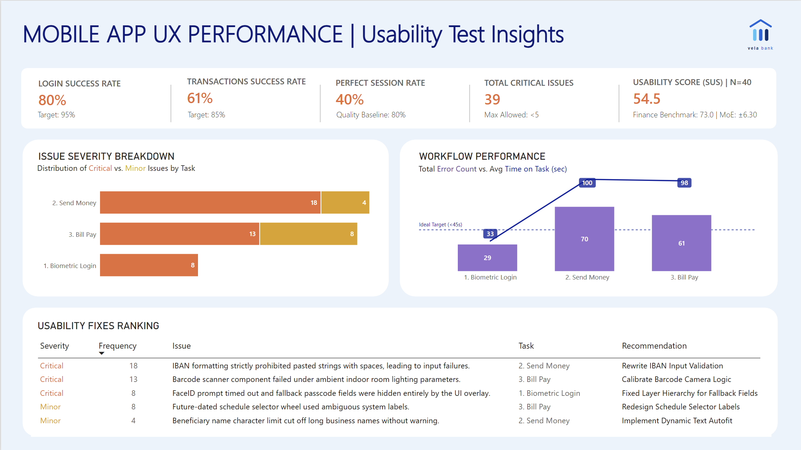
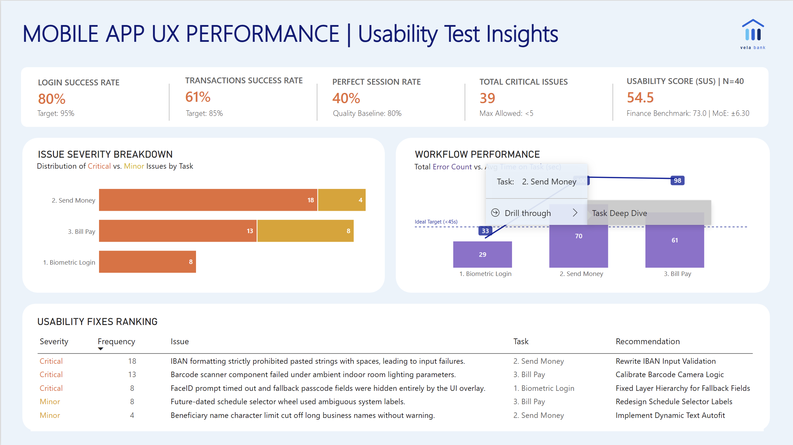
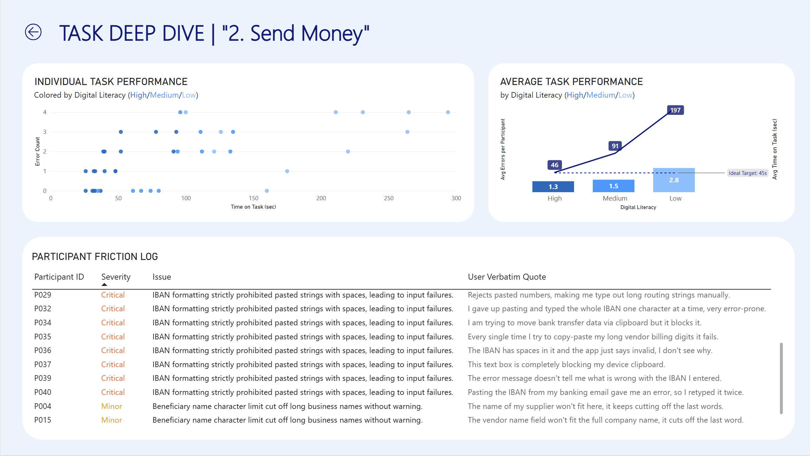
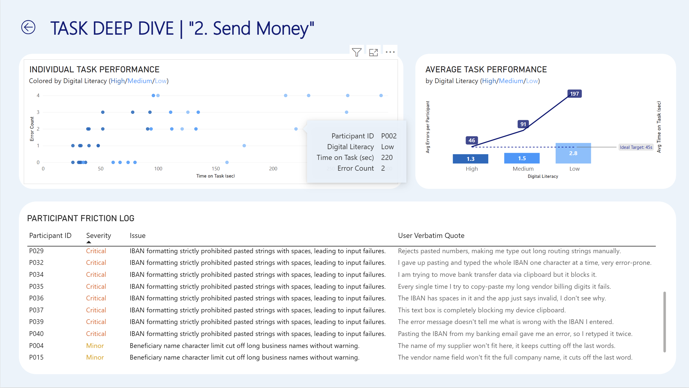

# Mobile App UX Performance: Usability Analytics Dashboard

From raw usability-test data to a **prioritised list of UX fixes for a simulated mobile banking app**, built with **Python** and **Power BI**.

## Project Overview

A usability test of a mobile banking app with **40 participants** completing **3 core tasks** (Biometric Login, Send Money, Bill Pay), plus the System Usability Scale (SUS) questionnaire and qualitative notes (51 recorded issues with user quotes).

The goal is to find where the app loses users, quantify it, and turn it into a ranked list of fixes a product team can act on.

> **Data note:** the dataset is simulated and was created for this portfolio project. "Vela Bank" and its logo are fictional. The project is about the method, not about a real product.

## Key findings

| KPI | Result | Target / baseline |
|---|---|---|
| Login success rate | 80% | 95% |
| Transactions success rate | 61% | 85% |
| Perfect session rate | 40% | 80% (quality baseline) |
| Total critical issues | 39 | fewer than 5 allowed |
| Usability score (SUS) | 54.5 (±6.3, 95% CI, n=40) | 73.0 (finance benchmark) |

- **Send Money is the weakest flow:** 55% success, about 100 s average time and 18 critical issues, mostly pasted IBANs with spaces being rejected.
- **Bill Pay:** 67.5% success and about 98 s average time. The barcode scanner fails under indoor lighting (13 critical issues).
- **Biometric Login** is the fastest task (about 33 s) but has 8 critical issues: the FaceID prompt times out and hides the fallback passcode field.
- **Errors and time go together:** correlation of 0.55 between error count and time on task. This is an association, not proof of cause.
- **Digital literacy gap (Send Money):** average time of 46 s (High), 91 s (Medium) and 197 s (Low); average errors per participant of 1.3, 1.5 and 2.8.
- **SUS scores are widely spread** (standard deviation 20.3), so a single average hides very different experiences. Segmenting by user group is more useful than the mean.

## Top priority fixes

| Severity | Frequency | Issue | Task | Recommendation |
|---|---|---|---|---|
| Critical | 18 | IBAN formatting rejects pasted strings with spaces | Send Money | Rewrite IBAN input validation |
| Critical | 13 | Barcode scanner fails under indoor lighting | Bill Pay | Calibrate barcode camera logic |
| Critical | 8 | FaceID prompt times out and hides fallback passcode fields | Biometric Login | Fix layer hierarchy for fallback fields |
| Minor | 8 | Future-dated schedule selector uses ambiguous labels | Bill Pay | Redesign schedule selector labels |
| Minor | 4 | Beneficiary name limit cuts off long business names | Send Money | Implement dynamic text autofit |

## Dashboard Preview

**Page 1: Executive Summary**
KPI cards against targets, issue severity by task, workflow performance (total errors vs average time, with a 45 s target line) and the usability fixes ranking.

**Page 2: Task Deep Dive** (drill-through from any task)
- Individual task performance: time vs errors per participant, coloured by digital literacy.
- Average task performance: average errors per participant and average time by digital literacy.
- Participant friction log with the issue and the user's verbatim quote.

## Method

1. **Data loading and quality checks:** data types optimised, logical boundaries checked.
2. **SUS scoring:** odd items minus 1, even items 5 minus the score, sum multiplied by 2.5. Mean, standard deviation, standard error and a 95% confidence interval (normal approximation).
3. **Exploratory analysis:** success rate per task, average time on task, error-time correlation, SUS distribution.
4. **Export and modelling:** four clean tables (`participants`, `task_performance`, `SUS_scores`, `qualitative_insights`) exported to CSV and loaded in Power BI. The `tasks` and `recommendations` tables and the DAX measures for the KPIs are built in Power BI.

## Tech stack

- Python 3: pandas, NumPy, SciPy, Matplotlib, Seaborn
- Jupyter Notebook
- Power BI Desktop and DAX

## Limitations

- Simulated data and a small sample (n = 40), so the intervals are wide.
- The confidence interval uses a normal approximation; a t-distribution would be slightly wider (about ±6.5).
- Targets and baselines (95%, 85%, 80%, fewer than 5 critical issues) and the SUS benchmark of 73.0 are reference values for this project. [Add the source of the benchmark.]
- Correlation between errors and time does not prove that errors cause the longer times.
- The user quotes are simulated and written to match each issue type.

## Author

**Sara Magni**  
*Data Analyst*

[sara.m4gn1.data@gmail.com](mailto:sara.m4gn1.data@gmail.com) | [LinkedIn](https://www.linkedin.com/in/sara-m4gn1/) | [GitHub](https://github.com/Sara-Magni)
